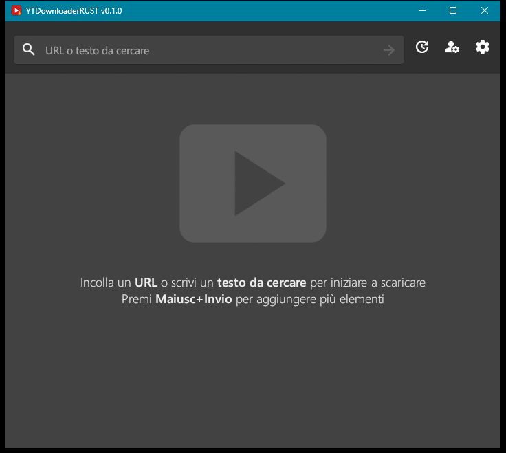
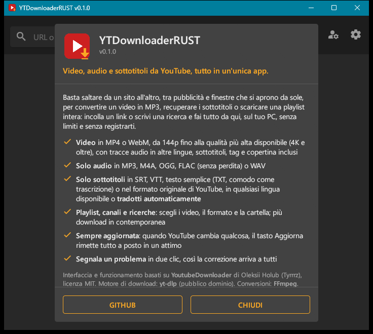

# YTDownloaderRUST

**Video, audio e sottotitoli da YouTube, tutto in un'unica app.** Versione 0.1.0 · 24 ottobre 2026.

Basta saltare da un sito all'altro, tra pubblicità e finestre che si aprono da sole, per convertire un video in MP3, recuperare i sottotitoli o scaricare una playlist intera: incolli un link o scrivi una ricerca e fai tutto da qui, sul tuo PC, senza limiti e senza registrarti.

| Finestra principale | Informazioni |
| --- | --- |
|  |  |

## Cosa fa

- **Video** in MP4 o WebM, da 144p fino alla qualità più alta disponibile (4K e oltre), con tracce audio in altre lingue, sottotitoli, tag e copertina incorporati.
- **Solo audio** in MP3, M4A, OGG, FLAC (senza perdita) o WAV.
- **Solo sottotitoli** in SRT, VTT, testo semplice (TXT, comodo come trascrizione) o nel formato originale di YouTube (RAW), in qualsiasi lingua disponibile, compresi quelli automatici e le **traduzioni automatiche** di YouTube.
- **Playlist, canali e ricerche**: si scelgono i video, il formato, la qualità e la cartella; più download in contemporanea (da 1 a 10).
- **Sempre aggiornata**: quando YouTube cambia qualcosa, il tasto Aggiorna rimette tutto a posto (vedi sotto).
- **Segnala un problema** in due clic, con versioni e messaggio d'errore già compilati.
- Tema scuro, chiaro o di sistema; interfaccia in italiano o in inglese.

## Avvio

Scarica **YTDownloaderRUST.exe** dalla [pagina delle release](https://github.com/gmy77/YTDownloaderRUST/releases/latest), mettilo in una cartella tua (per esempio `Strumenti\YTDownloaderRUST`) e avvialo: è un unico eseguibile, non serve installare nulla.

Al primo avvio l'app propone di scaricare **yt-dlp** (il motore che dialoga con YouTube) e, se non è già sul PC, **FFmpeg** (serve per unire audio e video e per le conversioni). Entrambi finiscono nella stessa cartella dell'app.

## Come si usa

Nella casella in alto si può scrivere:

- un link di YouTube: video, playlist o canale;
- un ID di video (11 caratteri) o di playlist;
- un canale come `@nomecanale`;
- un testo qualsiasi, che diventa una ricerca (o, per forzarla, un testo che inizia con `?`).

**Maiusc+Invio** va a capo e permette di inserire più link o ricerche in una volta sola. Per un video singolo si sceglie il formato in un elenco; per playlist, canali e ricerche si spuntano i video e si scelgono contenitore e qualità. Clic destro sull'elenco dei download per rimuovere quelli completati, riavviare quelli non riusciti o annullare tutto.

## Aggiornamenti

YouTube cambia spesso il modo in cui fornisce i video, e i programmi come questo smettono di funzionare finché non vengono adattati. YTDownloaderRUST si aggiorna su tre livelli, a ogni avvio (disattivabile) e con il tasto **Aggiorna**:

1. **yt-dlp**: è la parte che si rompe quando YouTube cambia, e i suoi autori la correggono di solito in pochi giorni. L'app ne scarica l'ultima versione ufficiale, verificata con l'hash SHA-256.
2. **Correzione rapida**: il file [`patch.json`](patch.json) di questo repository può aggiungere opzioni a yt-dlp per aggirare un problema appena scoperto, senza ricompilare l'app. Per sicurezza l'app accetta solo un elenco ristretto di opzioni innocue: niente che esegua comandi o scriva file.
3. **L'app stessa**: quando esce una nuova release, l'app la scarica, ne verifica l'hash e la installa; è attiva al riavvio.

## Segnalare un problema

Il pulsante con l'insetto (o clic destro su un download "Non riuscito" → *Segnala questo errore*) prepara una segnalazione con la descrizione, il messaggio d'errore, le versioni di app, yt-dlp e Windows e, se si vuole, il link del video. I percorsi delle cartelle personali vengono tolti. **APRI SU GITHUB** apre la pagina della [issue](https://github.com/gmy77/YTDownloaderRUST/issues) già compilata (serve un account GitHub gratuito); **COPIA** la mette negli appunti per inviarla in altro modo.

## Autenticazione

Alcuni video (con limiti di età, riservati agli abbonati, privati) richiedono l'accesso. Nella finestra *Autenticazione* si può scegliere di usare i cookie di un browser in cui si è già fatto l'accesso a YouTube (Firefox è la scelta più affidabile) oppure un file `cookies.txt`. L'app non copia né conserva i cookie: yt-dlp li legge a ogni richiesta.

## Compilazione da sorgente

Occorrono Windows x64, Rust stabile con target MSVC e i Microsoft C++ Build Tools con Windows SDK.

```powershell
git clone https://github.com/gmy77/YTDownloaderRUST.git
cd YTDownloaderRUST
cargo build --release
```

Il risultato è `target\release\ytdownloader-rust.exe`. Le prove: `cargo test --release` (senza rete) e `cargo test --release -- --ignored` (scaricano davvero un video di 19 secondi con lo yt-dlp presente nel PATH).

- `src/main.rs`: interfaccia, coda dei download, finestre di dialogo.
- `src/engine.rs`: riconoscimento delle query, scelta dei formati, download con yt-dlp, sottotitoli.
- `src/update.rs`: aggiornamenti di yt-dlp, dell'app e correzione rapida; download di yt-dlp e FFmpeg.
- `src/i18n.rs`: testi in inglese e italiano.

## Riconoscimenti e licenze

Interfaccia e funzionamento sono basati su [**YoutubeDownloader**](https://github.com/Tyrrrz/YoutubeDownloader) di Oleksii Holub (Tyrrrz), licenza MIT: YTDownloaderRUST ne è una riscrittura in Rust con motore yt-dlp e alcune funzioni in più (solo audio in più formati, solo sottotitoli con traduzioni, aggiornamenti e segnalazioni). Non è affiliato a quel progetto né a YouTube/Google.

Motore di download: [yt-dlp](https://github.com/yt-dlp/yt-dlp) (pubblico dominio). Conversioni: [FFmpeg](https://ffmpeg.org). Icone: Material Icons di Google (Apache 2.0). Le librerie incluse nell'eseguibile e le relative licenze sono in [THIRD-PARTY-NOTICES.md](THIRD-PARTY-NOTICES.md).

Il codice di YTDownloaderRUST è distribuito con licenza MIT (vedi [LICENSE](LICENSE)).

**Uso responsabile:** scarica solo contenuti di tua proprietà o che hai il diritto di salvare, nel rispetto del diritto d'autore e dei termini di servizio di YouTube.
