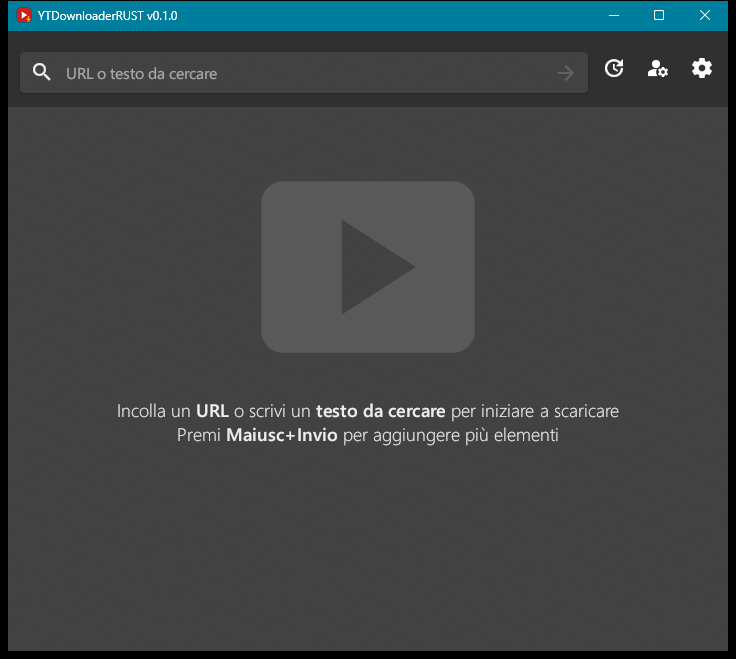
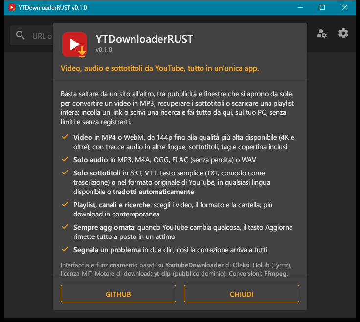

# YTDownloaderRUST

**English** · [Italiano](README.it.md)

**Video, audio and subtitles from YouTube, all in one app for Windows.** Version 0.1.1 · October 24, 2026.

No more jumping between ad-filled converter sites and pop-ups to turn a video into an MP3, grab its subtitles or save a whole playlist: paste a link or type a search and do it all from here, on your own PC, with no limits and no sign-up. A single portable `.exe` written in Rust, powered by [yt-dlp](https://github.com/yt-dlp/yt-dlp).

| Main window | About |
| --- | --- |
|  |  |

## Features

- **Video** in MP4 or WebM, from 144p up to the best quality available (4K and beyond), with extra audio languages, subtitles, tags and cover art embedded.
- **Audio only** in MP3, M4A, OGG, FLAC (lossless) or WAV.
- **Subtitles only** in SRT, VTT, plain text (TXT, handy as a transcript) or YouTube's original format (RAW), in any language available, including auto-generated captions and YouTube's **automatic translations**.
- **Playlists, channels and searches**: pick the videos, format, quality and folder; run 1 to 10 downloads at once.
- **Keeps working**: when YouTube changes something, the Update button puts things right (see below).
- **Report a problem** in two clicks, with versions and the error message already filled in. No account needed.
- Dark, light or system theme; interface in English or Italian.

## Getting started

Download **YTDownloaderRUST.exe** from the [releases page](https://github.com/gmy77/YTDownloaderRUST/releases/latest), put it in a folder of your own (for example `Tools\YTDownloaderRUST`) and run it: it is a single executable, nothing to install.

On first launch the app offers to download **yt-dlp** (the engine that talks to YouTube) and, if it is not already on your PC, **FFmpeg** (used to merge audio and video and for conversions). Both go into the app's folder.

> The executable is not code-signed yet, so Windows SmartScreen may show "Windows protected your PC". Click **More info → Run anyway**. You can check the file against `SHA256SUMS.txt` in the release.

## How to use it

In the box at the top you can type:

- a YouTube link: video, playlist or channel;
- a video ID (11 characters) or playlist ID;
- a channel as `@channelname`;
- any other text, which becomes a search (start it with `?` to force a search).

**Shift+Enter** adds a new line, so you can enter several links or searches at once. For a single video you pick the format from a list; for playlists, channels and searches you tick the videos and choose container and quality. Right-click the download list to clear finished items, retry failed ones or cancel everything.

## Updates

YouTube often changes the way it serves videos, and tools like this one stop working until they are adapted. YTDownloaderRUST updates itself on three levels, at every launch (can be turned off) and with the **Update** button:

1. **yt-dlp**: this is the part that breaks when YouTube changes, and its authors usually fix it within days. The app downloads the latest official release, verified with its SHA-256 hash.
2. **Quick fix**: the [`patch.json`](patch.json) file in this repository can add yt-dlp options to work around a newly found problem, without rebuilding the app. For safety the app only accepts a short list of harmless options: nothing that runs commands or writes files.
3. **The app itself**: when a new release is out, the app downloads it, checks its hash and installs it; it takes effect on restart.

## Reporting a problem

The bug button (or right-click a "Failed" download → *Report this error*) prepares a report with your description, the error message, the versions of the app, yt-dlp and Windows and, if you want, the video link. Personal folder paths are removed. **SEND** delivers it directly, no account needed: it becomes a [public issue](https://github.com/gmy77/YTDownloaderRUST/issues) on this project. **COPY** puts it on the clipboard so you can send it another way.

## Authentication

Some videos (age-restricted, members-only, private) require you to be signed in. In the *Authentication* dialog you can use the cookies of a browser where you are already signed in to YouTube (Firefox is the most reliable choice) or a `cookies.txt` file. The app does not copy or store the cookies: yt-dlp reads them on each request.

## Building from source

You need Windows x64, stable Rust with the MSVC target, and the Microsoft C++ Build Tools with the Windows SDK.

```powershell
git clone https://github.com/gmy77/YTDownloaderRUST.git
cd YTDownloaderRUST
cargo build --release
```

The result is `target\release\ytdownloader-rust.exe`. Tests: `cargo test --release` (offline) and `cargo test --release -- --ignored` (actually downloads a 19-second video with the yt-dlp found on the PATH).

- `src/main.rs`: interface, download queue, dialogs.
- `src/engine.rs`: query recognition, format selection, downloads with yt-dlp, subtitles.
- `src/update.rs`: yt-dlp and app updates, quick fix; downloading yt-dlp and FFmpeg.
- `src/i18n.rs`: English and Italian strings.

## Credits and licenses

The interface and behaviour are based on [**YoutubeDownloader**](https://github.com/Tyrrrz/YoutubeDownloader) by Oleksii Holub (Tyrrrz), MIT license: YTDownloaderRUST is a Rust rewrite with a yt-dlp engine and a few extra features (audio-only in more formats, subtitles-only with translations, self-updates and in-app reports). It is not affiliated with that project or with YouTube/Google.

Download engine: [yt-dlp](https://github.com/yt-dlp/yt-dlp) (public domain). Conversions: [FFmpeg](https://ffmpeg.org). Icons: Google Material Icons (Apache 2.0). The libraries bundled in the executable and their licenses are listed in [THIRD-PARTY-NOTICES.md](THIRD-PARTY-NOTICES.md).

YTDownloaderRUST is released under the MIT license (see [LICENSE](LICENSE)).

**Use responsibly:** only download content you own or have the right to save, respecting copyright and YouTube's terms of service.
